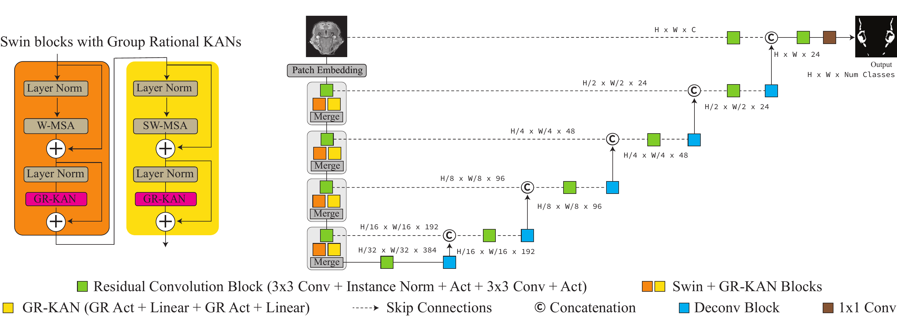

<div align="center">

# UKAST

### When Swin Transformer Meets KANs: An Improved Transformer Architecture for Medical Image Segmentation

<a href="https://arxiv.org/pdf/2511.04084"></a>


**Nishchal Sapkota, Haoyan Shi, Yejia Zhang, Xianshi Ma, Bofang Zheng, Fabian Vazquez, Pengfei Gu, and Danny Z. Chen**

[Paper](https://arxiv.org/pdf/2511.04084) · [Architecture](#architecture) · [Installation](#installation) · [Results](#results)

</div>

> **IEEE ISBI 2026** - UKAST combines the hierarchical context modeling of
> Swin Transformer with efficient Group Rational KAN (GR-KAN) feed-forward
> layers for data-efficient medical image segmentation.

## Overview

UKAST starts from MONAI's **SwinUNETR-v2** backbone and preserves its
stage-wise residual convolutions and U-shaped decoder. The only architectural
change is direct and deliberate: each Swin MLP is replaced by a token-wise
GR-KAN feed-forward block.

```text
Group Rational(identity) -> Linear -> Group Rational(swish) -> Linear
```

The rational activations give the feed-forward pathway more flexible nonlinear
function approximation, while grouped coefficients retain GPU efficiency.

## Architecture

<p align="center">
  
</p>

The encoder alternates windowed and shifted-window self-attention. At each
stage, SwinUNETR-v2 residual convolutions complement the GR-KAN-enhanced Swin
blocks; multi-scale encoder features connect to a CNN decoder through skip
connections.

## Results

UKAST achieves the best reported 3D benchmark results in the paper while
keeping essentially the same model size as SwinUNETR-v2 with residual
convolutions.

| Dataset | Modality | UKAST Dice (%) | SwinUNETR + RC | Difference |
|:--|:--|--:|--:|--:|
| Kvasir-SEG | Endoscopy (2D) | 81.7 | 81.9 | -0.2 |
| ISIC 2017 | Dermoscopy (2D) | **79.9** | 78.9 | **+1.0** |
| BCV 2016 | Abdominal CT (slice-wise) | **71.2** | 68.9 | **+2.3** |
| MMWHS 2017 | Cardiac MRI (slice-wise) | **80.8** | 80.4 | **+0.4** |

In the data-scarce setting, UKAST improves BCV Dice from **60.1% to 63.9%**
with only 10% of the training data, and ISIC Dice from **69.8% to 71.4%** at
the same fraction.

| Complexity | SwinUNETR + RC | UKAST |
|:--|--:|--:|
| Parameters | 7.183M | 7.184M |
| GFLOPs | 1.4419 | **1.4386** |

## Installation

Install a CUDA-compatible PyTorch build first, then install the model and the
KAT Triton dependency used in the completed experiments:

```bash
pip install -e '.[triton,dev]'
```

For CPU-only inspection or unit tests, install without the Triton extra and
pass `backend="torch"`. This selects the included mathematical reference
implementation of the same fixed-order GR-KAN operation.

## Quick start

```python
from ukast import UKAST

model = UKAST(
    in_channels=3,
    out_channels=2,
    spatial_dims=2,
    group_size=4,
    rational_init="swish",
    backend="triton",
)
```

The canonical published configuration is available at
[`configs/ukast_isbi2026.yaml`](configs/ukast_isbi2026.yaml). Inputs must meet
MONAI SwinUNETR's divisibility constraint: 32 pixels per spatial dimension for
`patch_size=2`.

## Reproducibility notes

- Experiments use 2D slices for the BCV and MMWHS volume datasets.
- The public code intentionally excludes register-token experiments,
  experimental architectures, data, checkpoints, and cluster scripts.
- The KAT Triton kernel is fixed to a fifth-degree numerator and fourth-degree
  denominator, so this release supports rational order `(5, 4)` only.

## Acknowledgments

UKAST builds on [MONAI SwinUNETR](https://github.com/Project-MONAI/MONAI)
(Apache-2.0) and the [KAT rational activation implementation](https://github.com/Adamdad/rational_kat_cu).
Please see their licenses before redistributing modified upstream code or
kernels.
